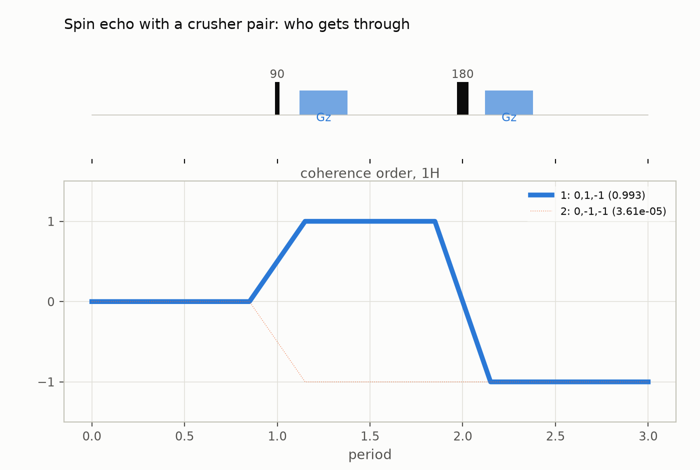
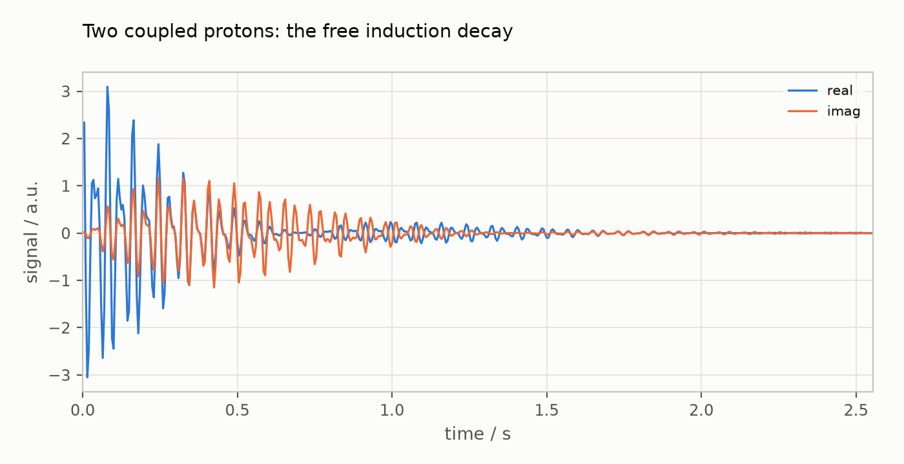

# Beyond the port

Most of Spynach is a port, checked stage by stage against Spinach. This guide
collects the add-ons originating here: features with no Spinach counterpart,
and modules that live beside the port. Each entry has a
short example and points to the guide that covers it in depth. The companion
notebook is [`notebooks/beyond-the-port.ipynb`](notebooks/beyond-the-port.ipynb)
([interactive figures on nbviewer](https://nbviewer.org/github/ajerschow/spynach/blob/main/docs/notebooks/beyond-the-port.ipynb)).

## Contents

1. [Coherence transfer pathway selection: `ctps`](#coherence-transfer-pathway-selection-ctps)
2. [Non-ideal pulses and cogwheel cycle search](#non-ideal-pulses-and-cogwheel-cycle-search)
3. [Interactive figures and static copies](#interactive-figures-and-static-copies)
4. [Checking results: `compare`, the parity page, timed reports](#checking-results-compare-the-parity-page-timed-reports)
5. [Executable documentation, Colab, contributed notebooks](#executable-documentation-colab-contributed-notebooks)
6. [Spynach in the browser](#spynach-in-the-browser)
7. [EPR with `epreasy`](#epr-with-epreasy)

## Coherence transfer pathway selection: `ctps`

Spinach simulates the spin dynamics of a sequence; it does not enumerate the
coherence transfer pathways a phase cycle or gradient scheme lets through.
`ctps`, a separate module in this repository (`import ctps`, no dependency on
`spynach`), ports the CCCP.m and CCCP++ programs (Jerschow & Müller, *J. Magn.
Reson.* 134, 17 (1998); Jerschow & Kumar, *J. Magn. Reson.* 160, 59 (2003)):
every pathway the allowed orders permit, weighted by the phase cycle, the
gradients, diffusion and the pulses, ranked, and drawn. A spin echo whose
180° pulse is 0.2 rad short, with a two-step cycle on that pulse and a crusher
pair around it: the cycle alone would let the non-inverted pathway through,
the crushers dephase it, and the pulse error sets how much of it exists:

```python
import numpy as np

from ctps import AllowedOrders, Nucleus, Period, PhaseCycle, Pulse, Sequence, simulate

ms = 1e-3
echo = Sequence(
    nuclei=(Nucleus("1H"),),
    pulses=(Pulse("1H", label="90"), Pulse("1H", "imperfect_180", beta=0.2, label="180")),
    periods=(Period(), Period.with_gradient(5 * ms, "z", 0.1, 1 * ms), Period.with_gradient(5 * ms, "z", 0.1, 1 * ms)),
    allowed={"1H": AllowedOrders.standard(1, 3)},
    diffusion=2e-9,
)
cycle = PhaseCycle.explicit(phases=[[0], [0, 2]], receiver=[0, 0], base=4)
result = simulate(echo, cycle, wanted=[(0, 1, -1)], cutoff=0)
for row in result.table():
    print(row["pathway"], f"pc {row['pc']:.2f}  grad {row['grad']:.4f}  diff {row['diff']:.3f}  pulse {row['pulse']:.3f}  total {row['total']:.2e}")
```

```python
from ctps.plot import plot_pathways

plot_pathways(result, top=5, title="Spin echo with a crusher pair: who gets through")
```



The explorer draws the sequence above the coherence orders, scales every
pathway's line width by its weight, and steps through the pathways with a
slider, listing the phase-cycle, gradient, diffusion and pulse factors of each.
[Coherence transfer pathways](ctps.md) is the full guide; `src/ctps/README.md`
says how to remove the module without touching Spynach.

## Non-ideal pulses and cogwheel cycle search

Two parts of `ctps` are new even relative to the programs it ports. Each pulse
can be declared a perfect 180°, an imperfect 180° (deviation `beta`, axis tilt
`epsilon`) or a small-flip-angle pulse, and the leakage of every coherence
transfer follows Jerschow, *J. Chem. Phys.* 113, 979 (2000), whose formulas and
tables were recomputed before use. And `find_cycle` searches cogwheel phase
cycles by exact integer arithmetic, testing all winding numbers at once as one
integer matrix product, with the symmetry reductions of the literature, while
`coverage` finds the best cycle for a fixed number of steps and
`crusher_scheme` optimises gradient areas with the DOTCOPS objective:

```python
from ctps import coverage, find_cycle, hcl_cycle

mqmas = Sequence.simple(n_pulses=3, p_max=3)
print("Hughes-Carravetta-Levitt construction:", hcl_cycle([3, 1], [3, 3]).cog_string())
print("smallest cycle found:", find_cycle(mqmas, [(0, 3, 1, -1)]).best.cog_string())
print("best 8-step cycle for sLASER:", coverage(Sequence.simple(5, 1), [(0, -1, 1, -1, 1, -1)], 8).best.cog_string())
```

## Interactive figures and static copies

Spinach draws into MATLAB figures. Spynach's `plot_1d` and `plot_2d` follow
Spinach's parameters but return interactive Plotly figures; `plot_fid`,
`plot_time_series` and `plot_trajan` have no Spinach counterpart, and
`figure_png` turns any of them into a PNG (through Kaleido when it can run,
otherwise a Matplotlib redraw) for GitHub, reports and papers. The notebooks in
this repository are saved with both the interactive figure and its PNG copy,
which is what GitHub's viewer shows.

```python
import spynach

spin_system = spynach.create(
    {"isotopes": ["1H", "1H"], "magnet": 14.1}, {"zeeman": {"scalar": [1.0, 1.1]}, "coupling": {"scalar": [[0, 12.0], [0, 0]]}}
)
spin_system = spynach.basis(spin_system, {"formalism": "zeeman-hilb", "approximation": "none"})
parameters = {"spins": ["1H"], "offset": 630, "sweep": 200, "npoints": 512,
              "rho0": spynach.state(spin_system, "L+", "1H"), "coil": spynach.state(spin_system, "L+", "1H")}
fid = spynach.apodisation(spynach.liquid(spin_system, spynach.acquire, parameters, "nmr"), [("exp", 6)])
```

```python
from spynach.plotting import figure_png, plot_fid

fig = plot_fid(fid, parameters, title="Two coupled protons: the free induction decay")
print(f"{len(figure_png(fig, scale=1)) / 1024:.0f} KB of PNG")
fig
```



## Checking results: `compare`, the parity page, timed reports

Spinach has no reference implementation to compare against; Spynach has
Spinach. `spynach.oracle.compare` is the normwise comparison behind the parity
suite and works on any pair of arrays, so a Spinach `.mat` result can be checked
against a Spynach run (see [Checking your own workflow against Spinach](coming-from-spinach.md#checking-your-own-workflow-against-spinach)).
[Parity with Spinach](parity.md), regenerated from the test suite, lists every
fixture case, tolerance and measured difference, and
[`comparison/README.md`](../comparison/README.md) is the protocol for timed and
profiled Spinach-vs-Spynach runs with an HTML report.

```python
from spynach.oracle import compare

reference = fid * (1 + 1e-11)  # stands in for the same FID computed by Spinach
print(compare(fid, reference, rtol=1e-9, atol=0, name="fid"))
```

## Executable documentation, Colab, contributed notebooks

Every guide in `docs/` is Markdown whose Python blocks run in the test suite,
with a notebook generated from it and saved with outputs
(`docs/build_notebooks.py`). `docs/colab/quick-start.ipynb` installs Spynach
in Google Colab and runs the quick-start example in the browser. `user_py/`
holds contributed notebooks, such as the triple-quantum build-up of a 23Na
spin under quadrupolar relaxation, beside the contributed Spinach scripts in
`user_ml/` and their translations in `examples/user_ml/`.

## Spynach in the browser

[`try.html`](https://ajerschow.github.io/spynach/try.html) on the project site
runs Spynach and `ctps` with nothing installed. The page loads
[Pyodide](https://pyodide.org/) (Python compiled to WebAssembly) with NumPy,
SciPy and h5py in a web worker, fetches the sources from the repository, and
runs the code in its editor; the first load takes a few seconds. The guides'
examples are there to start from. Results are drawn with `show_spectrum(y,
x)`, `show_fid(fid, sweep)` and `show_image(z, x, y)` (2D contours, high ppm at
the left and bottom as in `plot_2d`). Without these calls, a variable named
`spectrum` (with `axis`) or `fid` with `sweep` is plotted at the end. Powder and
magic-angle-spinning runs print their orientation count as they go, through
the optional `parameters["progress"]` callback of `powder` and `singlerot`,
which works the same way outside the browser:

```python
csa_system = spynach.create({"isotopes": ["1H"], "magnet": 14.1}, {"zeeman": {"eigs": [[-2, -2, 4]], "euler": [[0, 0, 0]]}})
csa_system = spynach.basis(csa_system, {"formalism": "sphten-liouv", "approximation": "none"})
powder_pars = {"spins": ["1H"], "offset": 0.0, "sweep": 2e4, "npoints": 64, "grid": "leb_2ang_rank_11",
               "rho0": spynach.state(csa_system, "L+", "1H"), "coil": spynach.state(csa_system, "L+", "1H"),
               "progress": lambda done, total: print(f"orientation {done}/{total}") if done % 10 == 0 else None}
powder_fid = spynach.powder(csa_system, spynach.acquire, powder_pars, "nmr")
```

The page was contributed by Moritz Zaiss (MRsources). It runs in a single thread,
so it suits guide-sized examples rather than full-size calculations.

## EPR with `epreasy`

Spinach covers EPR as time-domain spin dynamics; the field-swept, resonance-field
and slow-motion methods of EPR spectroscopy belong to
[EasySpin](https://easyspin.org) (Stefan Stoll and co-workers). `epreasy` is a
separate package in this repository (`import epreasy`) that ports EasySpin to
Python with EasySpin's interface: spin systems as dicts with EasySpin's field
names, fields in mT, energies in MHz, 1-based spin numbers. It depends on
`spynach` and changes nothing in it. It has the foundation (`validatespinsys`,
`sop`, `stev`, `ham` with the split `H = H0 - B·mu` that makes field sweeps
cheap, `levels`), `resfields` and the line shapes, and the cw simulators
`pepper` (powders and crystals) and `garlic` (solutions), all verified
against EasySpin 6.0.15 ([EPR spin systems with `epreasy`](epreasy.md),
[Coming from EasySpin](coming-from-easyspin.md)):

```python
import epreasy as es

nitroxide = {"g": [2.0088, 2.0061, 2.0027], "Nucs": "14N", "A": [16, 16, 86]}
print("levels at 340 mT along z (MHz):", es.levels(nitroxide, "z", 340).round(1))
powder = es.pepper({**nitroxide, "lwpp": 0.3}, {"mwFreq": 9.5, "Range": [330, 350]}, {"FuzzLevel": 0})
print("powder spectrum:", powder.spec.shape, "points, extrema at", powder.x[[powder.spec.argmax(), powder.spec.argmin()]].round(2), "mT")
```
