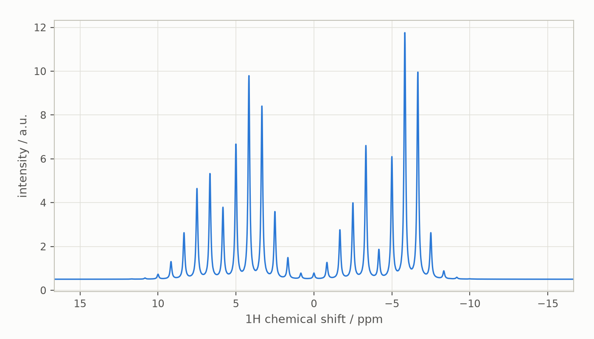

# Magic angle spinning

This guide covers sample rotation: how Spynach, like Spinach, treats the
rotor phase as a coordinate of the problem (the Fokker-Planck formalism
of Kuprov 2016) and what the `singlerot` context does with it. It builds
on the [solid-state](solid-state.md) guide, which explains the
orientation-dependent Hamiltonian and the powder grids, and on the
[Liouville-space](liouville-space.md) guide. The companion notebook is
[`notebooks/magic-angle-spinning.ipynb`](notebooks/magic-angle-spinning.ipynb) ([interactive figures on nbviewer](https://nbviewer.org/github/ajerschow/spynach/blob/main/docs/notebooks/magic-angle-spinning.ipynb)).

Every Python block is executed by `tests/docs/`, in order and in one
namespace.

## Contents

1. [The rotor phase as a coordinate](#the-rotor-phase-as-a-coordinate)
2. [The `singlerot` context](#the-singlerot-context)
3. [Sidebands and rotor echoes](#sidebands-and-rotor-echoes)
4. [Single crystals and the rotor axis](#single-crystals-and-the-rotor-axis)
5. [What is not ported yet](#what-is-not-ported-yet)
6. [Checking results against Spinach](#checking-results-against-spinach)

## The rotor phase as a coordinate

Under sample rotation the Hamiltonian depends on time through the rotor
phase, `H(phi)` with `phi = 2 pi rate t`. Instead of stepping a
time-dependent Hamiltonian, the Fokker-Planck formalism treats `phi` as a
coordinate: the state becomes a function `rho(phi, t)` on a grid of
`2 max_rank + 1` rotor phases, and the equation of motion gains the
rotor-turning term, a derivative with respect to `phi`:

    d rho / dt = -i [H(phi), rho] + 2 pi rate * d rho / d phi

The generator is then time independent: the block-diagonal stack of the
Hamiltonians at the grid phases plus `i 2 pi rate (D_phi (x) 1)`, where
`D_phi` is the Fourier spectral differentiation matrix, exact for every
harmonic the grid resolves (`spynach.contexts.fourdif`):

```python
import numpy as np
import spynach
from spynach.contexts import fourdif

phases, D1 = fourdif(9, 1)
print(phases / (2 * np.pi / 9))
f = np.exp(3j * phases)
print(np.abs(D1 @ f - 3j * f).max())          # d/dphi of exp(i k phi) is exact for k up to 4
```

The state vector is the stack of the spin state at every rotor phase, spin
index fastest (`rho.reshape(spc_dim, spn_dim)`), the layout Spynach uses for
every composite space; `parameters["spc_dim"]` and `["spn_dim"]` tell a
pulse sequence the two dimensions. Everything downstream (`evolution`,
the reductions, `acquire`) works on the larger vectors unchanged: zero
track elimination and path tracing see the Fokker-Planck generator as just
another sparse matrix.

## The `singlerot` context

`singlerot(spin_system, sequence, parameters, assumptions)` needs, beyond the
`powder` parameters, `rate` (Hz), `axis` (the rotor direction in the lab
frame; `[1, 1, 1]` is the magic angle) and `max_rank` (the rotor phase grid
resolves sidebands up to that order, so it has to exceed the ratio of the
anisotropy to the spinning rate). For each orientation of the spherical
grid it composes three rotations for every rotor phase, molecule → rotor
(the grid angles), the rotor phase itself, and rotor → lab (the axis),
contracts the `Q` components with the composed Wigner matrices, assembles
the generator, replicates `R` and `K` over the phases, averages the
initial state over the rotor phase (a powder has every rotor phase at
`t = 0`), replicates the coil, and runs the sequence. The same optional
`parameters["progress"](done, total)` callback as `powder` runs after each
orientation. Spinach's
`examples/nmr_solids/mas_powder_csa_fplanck.m` with a coarser grid:

```python
spin_system_csa = spynach.create({"isotopes": ["1H", "1H"], "magnet": 14.1},
                    {"zeeman": {"eigs": [[-7, -7, -1], [4, 2, 9]], "euler": [[0, 0, 0], [0, 0, 0]]}})
spin_system_csa = spynach.basis(
    spin_system_csa, {"formalism": "sphten-liouv", "approximation": "none", "projections": [[1]]}
)
pars = {"spins": ["1H"], "offset": 0.0, "rate": 500.0, "axis": [1, 1, 1], "max_rank": 17,
        "grid": "leb_2ang_rank_17", "sweep": 2e4, "npoints": 512, "zerofill": 4096, "axis_units": "ppm",
        "rho0": spynach.state(spin_system_csa, "L+", "1H"), "coil": spynach.state(spin_system_csa, "L+", "1H")}
fid = spynach.singlerot(spin_system_csa, spynach.acquire, pars, "nmr")
```

```python
from spynach.plotting import plot_1d

fid_apod = fid * np.exp(-6 * np.arange(pars["npoints"]) / pars["npoints"])
spectrum = np.fft.fftshift(np.fft.fft(fid_apod, pars["zerofill"]))
plot_1d(spin_system_csa, spectrum.real, {**pars, "invert_axis": True})
```



The static powder pattern of the solid-state guide breaks up into a
centreband at each isotropic shift and spinning sidebands 500 Hz apart.

## Sidebands and rotor echoes

For a single spin with a shielding tensor the Hamiltonian commutes with
itself at every rotor phase, so the signal refocuses exactly once per
rotor period, with the phase of the isotropic shift; between the echoes
the anisotropy dephases it. Spinning far above the anisotropy averages it
to nothing and leaves the isotropic shift:

```python
spin_system_single = spynach.create(
    {"isotopes": ["1H"], "magnet": 14.1}, {"zeeman": {"eigs": [[4, 2, 9]], "euler": [[0.3, 0.9, 1.2]]}}
)
spin_system_single = spynach.basis(
    spin_system_single, {"formalism": "sphten-liouv", "approximation": "none", "projections": [[1]]}
)
p1 = {
    **pars,
    "rho0": spynach.state(spin_system_single, "L+", "1H"),
    "coil": spynach.state(spin_system_single, "L+", "1H"),
    "npoints": 161,
}
fid_one = spynach.singlerot(spin_system_single, spynach.acquire, p1, "nmr")
period = int(round(p1["sweep"] / p1["rate"]))                      # dwell times per rotor period
echoes = fid_one[::period]
print(np.abs(echoes).round(6), abs(fid_one[period // 2]).round(3))   # exact rotor echoes, dephased in between
iso = spin_system_single.basefrqs[0] * 5e-6
print(np.angle(echoes[1] / echoes[0]), np.angle(np.exp(-1j * iso / p1["rate"])))   # the isotropic shift phase
fast = spynach.singlerot(
    spin_system_single, spynach.acquire, {**p1, "rate": 5e5, "max_rank": 5, "npoints": 64}, "nmr"
)
t = np.arange(64) / p1["sweep"]
print(np.abs(fast - fast[0] * np.exp(-1j * iso * t)).max())   # only the isotropic shift is left
```

With several spins the echoes of the sum beat at the differences of the
isotropic shifts modulo the spinning rate: the rotor period samples the
isotropic precession.

## Single crystals and the rotor axis

With the `single_crystal` grid the initial state sits at rotor phase zero
instead of being averaged, and the molecule is placed at the grid
orientation `(0, 0, 0)` rotated by the rotor → lab transformation. At zero
spinning rate and `max_rank = 0` the context reduces to `crystal` at that
orientation; an off-axis rotor direction gives a non-magic-angle
experiment:

```python
static = {**p1, "rate": 0.0, "max_rank": 0, "grid": "single_crystal", "npoints": 32}
fid_static = spynach.singlerot(spin_system_single, spynach.acquire, static, "nmr")
rotor_phi, rotor_theta = np.arctan2(1, 1), np.arccos(1 / np.sqrt(3))
fid_crystal = spynach.crystal(
    spin_system_single, spynach.acquire, {**static, "orientation": [rotor_phi, rotor_theta, 0]}, "nmr"
)
print(np.abs(fid_static - fid_crystal).max())
off_axis = spynach.singlerot(
    spin_system_single, spynach.acquire, {**p1, "axis": [0.5, 0.2, 1.0], "max_rank": 7, "npoints": 64}, "nmr"
)
```

## What is not ported yet

- the `doublerot`, `floquet` and `gridfree` treatments of rotation, and
  the imaging contexts;
- `singlerot` in Hilbert space (Spinach hands the sequence a list of
  Hamiltonians there), `parameters["needs"]`, extra rotating frames and
  orientation-dependent initial states;
- the polyadic (unopened Kronecker product) representation of the
  Fokker-Planck generator: Spynach builds it as an explicit sparse matrix,
  as `singlerot.m` does.

## Checking results against Spinach

`tests/unit/test_mas.py` checks the spectral derivative on resolved
harmonics, exact rotor echoes and their phases for every orientation,
the beat of two spins' echoes, the fast-spinning limit, the static limit
against `crystal`, and the Fokker-Planck layout of the states and the
generator. `tests/slice/test_mas_parity.py` compares the rotor grid and
derivative, the Fokker-Planck generator at the first grid orientation, the
expanded states, and the `singlerot` FIDs and spectra of four systems (CSA
pair, dipolar pair, 2H quadrupole, single crystal off the magic angle)
with Spinach 2.13 fixtures (FR-006 in `porting/FIXTURE_REQUESTS.md`);
those tests skip while the fixtures are absent. Measured agreement over
the four cases (largest elementwise difference relative to the largest
element):

| stage | difference from Spinach |
|---|---|
| rotor phase grids and spectral derivative matrices | 5e-17 |
| Fokker-Planck generators (up to 75 x 75) | 0 (identical) |
| expanded initial and detection states | 0 |
| `singlerot` FIDs and spectra (128 points, 50 orientations) | 1e-13, 5e-14 |
